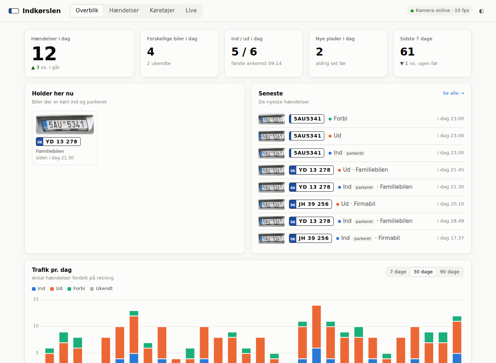

# Indkørslen: nummerpladegenkendelse

Et selvhostet program til en Linux-server. Det kigger ud i indkørslen gennem et
IP-kamera, aflæser nummerpladerne på de biler der kommer, og registrerer om
bilen **kører ind, kører ud, holder parkeret eller kører forbi**. Alt gemmes i
en lokal database og vises i et dashboard med statistik.



**Funktioner**

- Lokal AI-genkendelse ([fast-alpr](https://github.com/ankandrew/fast-alpr), ONNX). Ingen cloud og intet abonnement. Kører på CPU med ca. 30 ms pr. billede.
- Bevægelsesdetektor, så der kun analyseres når noget sker (lavt CPU-forbrug).
- Følger hver bil over mange billeder og stemmer om det mest sandsynlige nummer, så enkelte fejllæsninger ignoreres. Dansk format (`AB 12 345`) får bonus, og typiske forvekslinger (O/0, B/8, S/5 …) rettes. Personlige og udenlandske plader virker også.
- **Retning:** ind / ud / forbi / ukendt, ud fra om pladen bliver større eller mindre, eller hvilken vej den bevæger sig i billedet.
- **Parkering:** en bil der står stille i 20 s registreres som parkeret. Når den kører igen, registreres afgangen, og opholdets længde beregnes.
- **Dashboard:** dagens tal, "holder her nu", trafik pr. dag, tidspunkt på døgnet, varmekort over ugedag og time, hyppigste biler, historik pr. plade, live-billede med markeringer, lyst og mørkt tema, virker på mobil.
- Giv kendte biler navn og kategori ("Familiebilen", "Mormor", "Postnord" …). Ret fejllæsninger direkte i dashboardet.
- CSV-eksport, JSON-API og webhook til fx Home Assistant.
- Billeder af hver hændelse (hele billedet og nærbillede af pladen) slettes automatisk efter 90 dage.

**Hvilket kamera skal jeg købe?** Se **[docs/kamera-guide.md](docs/kamera-guide.md)**.
Kort fortalt: et PoE-kamera med motorzoom og manuel lukkertid, fx en Dahua 4 MP
WizSense med 2,7–13,5 mm zoom (ca. 1.000–1.600 kr.). Det billigste der stadig
virker er en Reolink RLC-811A.

---

## Kom i gang

### Med Docker (anbefalet)

```bash
git clone <repo> driveway-lpr && cd driveway-lpr
cp config.example.yaml config.yaml
nano config.yaml            # sæt camera.source til dit kameras RTSP-adresse
docker compose up -d --build
```

Åbn `http://<server-ip>:8080`.

### Uden Docker

Kræver Python 3.10 eller nyere.

```bash
python3 -m venv .venv && . .venv/bin/activate
pip install -r requirements.txt
cp config.example.yaml config.yaml && nano config.yaml
python -m driveway_lpr run
```

AI-modellerne (ca. 11 MB) hentes automatisk første gang. Til drift kan
`deploy/driveway-lpr.service` bruges som systemd-service.

### Prøv uden kamera

```bash
python -m driveway_lpr demo --days 60      # fyld databasen med 60 dages demo-data
python -m driveway_lpr web                 # kun dashboard
python -m driveway_lpr image foto.jpg --out resultater/   # test genkendelse på et billede
```

En videofil kan også bruges som "kamera": `camera.source: /sti/video.mp4`
(`realtime: false` behandler den så hurtigt som muligt).

## Indstilling: sådan får du det til at virke godt

1. **Live-fanen:** Åbn dashboardet og gå til *Live*. Den gule ramme er analyseområdet, grønne firkanter er fundne plader, og det orange spor viser bilens bevægelse.
2. **Analyseområde:** Sæt `detection.roi` så kun indkørslen er med, fx `[0.2, 0.3, 0.9, 1.0]` (brøkdele af billedets bredde og højde). Det gør genkendelsen hurtigere og bedre og holder vejen ude.
3. **Test billeder:** Gem et stillbillede fra kameraet og kør `python -m driveway_lpr image billede.jpg`. Er pladen under ca. 100 px bred, så zoom kameraet mere ind, eller vælg `detector_model: yolo-v9-t-640-license-plate-end2end`.
4. **Retning:**
   - Kameraet sidder ved huset og kigger ud mod vejen (standard): `method: size`, `approaching_is_in: true`.
   - Kameraet sidder ved vejen og kigger ind mod huset: `approaching_is_in: false`.
   - Kameraet ser indkørslen fra siden: `method: vector` og `in_vector` sat til den retning i billedet, der betyder "ind", fx `[1, 0]` = mod højre.
5. **Om natten:** Se afsnittet om kameraindstillinger i kameraguiden (lukkertid og IR). Det er det, der oftest går galt.

Alle indstillinger er beskrevet i [`config.example.yaml`](config.example.yaml). Alle
kan også sættes som miljøvariabler (`LPR_CAMERA__SOURCE=...`, `LPR_WEB__PASSWORD=...`).

## Sådan virker det

```
kamera (RTSP) ─▶ bevægelse? ─▶ find plade + OCR ─▶ tracker ─▶ SQLite ─▶ dashboard / API
                  (billigt)      (fast-alpr, ONNX)    │
                                                      ├─ stemmer om pladenummeret over mange billeder
                                                      ├─ ind / ud / forbi ud fra pladens størrelse og bevægelse
                                                      ├─ står stille i 20 s → parkeret
                                                      └─ snapshot + webhook
```

| Fil | Indhold |
|---|---|
| `driveway_lpr/camera.py` | Henter billeder i en baggrundstråd og genopretter forbindelsen automatisk |
| `driveway_lpr/motion.py` | Bevægelsesdetektor (MOG2) inden for analyseområdet |
| `driveway_lpr/recognizer.py` | Pladedetektor og OCR (fast-alpr) |
| `driveway_lpr/plates.py` | Normalisering, dansk format, rettelse af forvekslinger, afstemning |
| `driveway_lpr/tracker.py` | Følger plader mellem billeder, bestemmer retning og parkering, laver hændelser |
| `driveway_lpr/storage.py` | SQLite (hændelser og køretøjer) og statistik |
| `driveway_lpr/pipeline.py` | Binder delene sammen, gemmer snapshots, live-billede |
| `driveway_lpr/web/` | FastAPI og dashboard (vanilla JS + Chart.js, intet build-trin) |

## Webhook / Home Assistant

Sæt `notify.webhook_url`. Ved hver hændelse sendes en POST med JSON:

```json
{
  "title": "AB 12 345 - ind (parkeret)",
  "message": "Familiebilen: AB 12 345 kørte ind kl. 16:52",
  "plate": "AB12345", "plate_formatted": "AB 12 345",
  "direction": "in", "direction_da": "ind", "parked": true,
  "known": true, "label": "Familiebilen", "category": "beboer",
  "confidence": 0.97, "time": "2026-10-03T16:52:11+02:00",
  "snapshot": "/snapshots/2026/10/03/165211_AB12345_17.jpg"
}
```

Home Assistant-automation:

```yaml
trigger:
  - platform: webhook
    webhook_id: indkoersel
    local_only: true
action:
  - service: notify.mobile_app_din_telefon
    data:
      title: "{{ trigger.json.title }}"
      message: "{{ trigger.json.message }}"
```

Med `only_unknown: true` får du kun besked om biler, du ikke har registreret.
Biler med "Send notifikation" slået til, eller med kategorien *Uønsket*, giver altid besked.

## API

Interaktiv dokumentation: `http://<server>:8080/api/docs`. De vigtigste endpoints:

| Endpoint | |
|---|---|
| `GET /api/summary` | Dagens tal og biler der holder her nu |
| `GET /api/events?plate=&direction=&days=&known=` | Hændelser (sideinddelt) |
| `PATCH /api/events/{id}` | Ret plade og retning (`apply_to_all` retter på alle hændelser) |
| `GET /api/stats/daily`, `/hourly`, `/heatmap`, `/top` | Statistik |
| `GET /api/plates/{plade}` | Profil og historik for én plade |
| `GET/PUT/DELETE /api/vehicles/{plade}` | Kendte køretøjer |
| `GET /api/export.csv` | CSV (semikolon-separeret, åbner direkte i Excel) |
| `GET /api/live.mjpg`, `/api/live.jpg` | Live-billede med markeringer |

## Sikkerhed

Dashboardet viser nummerplader og billeder. Sæt `web.username` og `web.password`,
hvis andre end dig kan nå serveren. Vil du kunne se dashboardet uden for
hjemmet, så brug VPN (fx WireGuard eller Tailscale) i stedet for at åbne en port i routeren.

## Udvikling

```bash
pip install -r requirements.txt pytest httpx
python -m pytest
```
